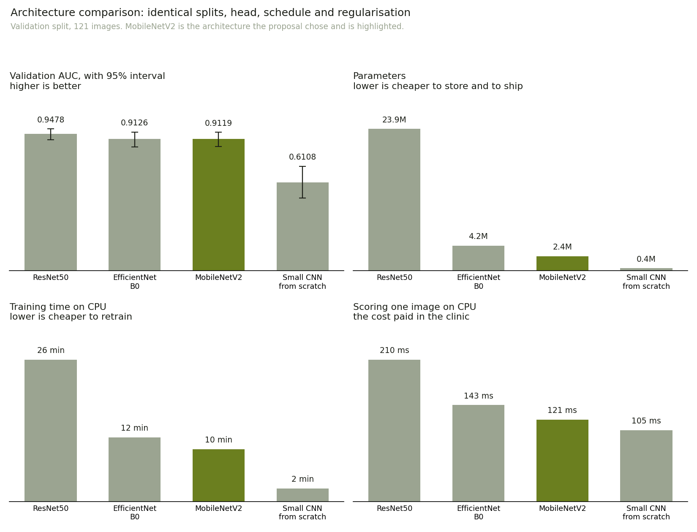

# Which architecture, and why

Produced by `ml/scripts/compare_architectures.py`. Regenerate rather than edit.

## The question

Proposal section 3.2.3 names MobileNetV2 and justifies it by deployment: a
clinic in a resource-constrained setting runs this on a CPU, so the model has
to be small and fast. That is a reason to prefer a compact network. It is not
evidence that a compact network is good enough, and the two are different
claims. This compares it against the alternatives to settle the second one.

## What was held constant

Every run below used the same stratified 70/15/15 manifest seeded at 42, the
same classification head, the same two-stage schedule of 30 head epochs then
15 fine-tuning epochs with early stopping, the same 60 unfrozen base layers at
a fine-tuning rate of 1e-4, the same dropout of 0.5 and weight decay of 1e-4,
light augmentation and a batch size of 32.

The one thing that necessarily differs is the input convention each network
was pretrained on. `ml/preprocessing.py` remains the single source of truth for
reading an image off disk, and the conversion happens inside the model, so the
pixels are identical and only the convention changes.

All selection is on the validation split. The test split was not read.

## Results

| Architecture | Parameters | Validation AUC | 95% CI | vs MobileNetV2 | Training | One image |
|---|---:|---:|---:|---:|---:|---:|
| ResNet50 | 23,866,497 | **0.9478** | [0.906, 0.981] | +0.0359 | 26 min | 210 ms |
| EfficientNetB0 | 4,226,980 | **0.9126** | [0.858, 0.959] | +0.0007 (overlaps) | 12 min | 143 ms |
| MobileNetV2 | 2,435,393 | **0.9119** | [0.860, 0.957] | reference | 10 min | 121 ms |
| Small CNN, no pretraining | 436,337 | **0.6108** | [0.503, 0.722] | -0.3011 | 2 min | 105 ms |

## What it shows

ResNet50 scores 0.9478 against MobileNetV2's 0.9119, an advantage of 0.0359 AUC. That gap carries a 95 per cent confidence interval of [+0.0022, +0.0744], which excludes zero, so the advantage is real on this split and not an artefact of the sample. It costs 9.8 times the parameters. Whether that is worth paying depends on the deployment, and this project's deployment is a clinic running inference on a CPU without a GPU. A model that scores better but cannot run where the patients are has no sensitivity at all. The proposal's choice stands on that basis rather than on accuracy, which is a weaker claim than winning outright and is reported as such.

## The size argument, stated properly

The larger network carries roughly 10 times the parameters, and its saved file is 95 MB against 10 MB. That cost is paid in three places: in every inference on a machine without a GPU, in every retraining, and in the Windows executable this project ships as its final deliverable, which has to carry the weights inside it.

On this machine the difference in scoring one image is 210 ms against 121 ms. That is the weaker half of the argument and is stated rather than leaned on: at this scale both are fast enough for a clinic, and it is the file size and the retraining cost that carry the decision.

## What this comparison does not establish

- 4 architectures, one run each. The confidence intervals above
  describe sampling variation in the 121 validation images. They say nothing
  about variation between training runs: the same architecture trained again
  with a different seed would land somewhere slightly different, and that
  source of uncertainty is not measured here. Repeated runs per architecture
  would be needed to separate the two.
- Each alternative was given the schedule tuned for MobileNetV2. A network
  tuned for itself might do better, so a loss here is not proof of a worse
  architecture, only of a worse architecture under these settings.
- Validation only, on 121 images. The ordering could differ on the test split,
  which was deliberately not consulted.
