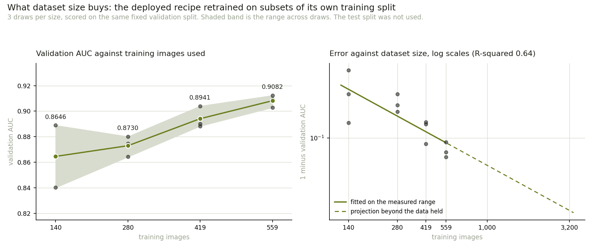

# Does the dataset size limit this model?

Produced by `ml/scripts/learning_curve.py`. Regenerate rather than edit.

## The question

The dataset is 800 images, 559 of them training. Any reader will notice, and
"small" is the easiest criticism to make of a medical imaging result. It is also
not a finding on its own. What matters is whether performance is still improving
with each image added, or whether it stopped improving before the data ran out.

Those two situations call for opposite conclusions. A curve still climbing says
the dataset is the binding constraint and more radiographs are the remedy. A
curve already flat says more of the same images would change nothing, and the
limit is the architecture, the labels, or the population the images came from.

## How it was measured

The deployed recipe was retrained on 25, 50, 75 and 100
per cent of the training split, 3 times at each size from a different
stratified draw, and scored each time on the same fixed validation split of
121 images. The test split was not loaded.

Every setting is the one the promoted model was trained with, so the 100 per cent
points retrain the deployed model exactly:

| Setting | Value |
|---|---|
| Architecture | MobileNetV2, ImageNet weights |
| Augmentation | light |
| Dropout | 0.5 |
| Weight decay | 0.0001 |
| Batch size | 32 |
| Head epochs | 30, early stopping on validation AUC |
| Fine-tuning | last 60 base layers at 0.0001 |

Draws are stratified by class. A plain random draw of a quarter of the images
could shift the TB share by several points, and that shift would appear in the
curve as an effect of dataset size when it is nothing of the kind.

The training seed changes with the draw, so the spread at each size includes the
run-to-run noise of this training procedure rather than hiding it. At 100 per
cent every run sees identical images, so the spread there is that noise alone,
and it is the bar a gap between sizes has to clear to count as a gap.

## What it shows

| Training images | Share | Mean AUC | Range across draws | Standard error |
|---|---|---|---|---|
| 140 | 25% | 0.8646 | 0.8402 to 0.8889 | 0.0141 |
| 280 | 50% | 0.8730 | 0.8643 to 0.8801 | 0.0046 |
| 419 | 75% | 0.8941 | 0.8883 to 0.9040 | 0.0050 |
| 559 | 100% | 0.9082 | 0.9029 to 0.9123 | 0.0028 |

Dataset size matters, and measurably: 140 training images give 0.8646 validation AUC and 559 give 0.9082, a rise of 0.0436 against the 0.0287 this measurement can resolve. It is still rising where the data stops, by 0.0141 over the last 140 images, clear of the 0.0114 resolution. The dataset is a binding constraint rather than a cosmetic complaint: this model has not finished learning from images it does not have. Fitted as a power law, error falls 17 per cent for each doubling of the training set (R-squared 0.64). Extended, that puts AUC 0.93 at about 1,861 training images, roughly 3.3 times what is held. That is an extrapolation beyond 559 images and is a projection, not a result: it assumes more images of the same kind, labelled the same way, and real curves bend where a fit does not.

AUC is the measure here because it does not depend on a threshold. Sensitivity
at a fixed 0.5 cut-off is recorded per run in `learning_curve.json` but is not
reported above, and should not be: each run calibrates differently, so at an
untuned threshold sensitivity swings with the run rather than with the dataset.
The deployed model's threshold is chosen on validation after training, at 0.102,
and doing that for twelve throwaway models would measure the threshold search
rather than the dataset.

## The projection, and what it is worth

Learning curves are conventionally modelled as a power law in the error rather
than in the score: the error falls by a fixed proportion for each doubling of
the data. Fitting a straight line through log(error) against log(images) is two
parameters rather than three, which is as much as 12 noisy points can carry. Every run is fitted, not the four means.

The fit has R-squared 0.64 and an exponent of -0.268.

| Training images | Projected AUC |
|---|---|
| 1,000 (extrapolated) | 0.9173 |
| 1,600 (extrapolated) | 0.9271 |
| 3,200 (extrapolated) | 0.9395 |

Read these as a projection and nothing stronger. They assume more images of
the same kind, labelled to the same standard, from the same two source
collections, and they assume the curve keeps the shape it had over a range
of 140 to 559 images. Real learning curves bend where a two-parameter fit does not.

## What this does not say

The yardstick is itself small. Every AUC here is measured on 121
validation images, so each point carries a sampling error of its own that has
nothing to do with how many images the model trained on. The curve measures the
effect of training size against a fixed and noisy ruler; it does not make the
ruler longer.

Nor does it speak to the population. Montgomery County and Shenzhen are not
Kenya, and a curve showing that more images of the same kind would help says
nothing about whether images of the same kind are the ones that should be
collected. `ml/artifacts/cross_dataset.json` is where that question is measured.

Total training time for this measurement: 89 minutes across 12 runs on a CPU.
