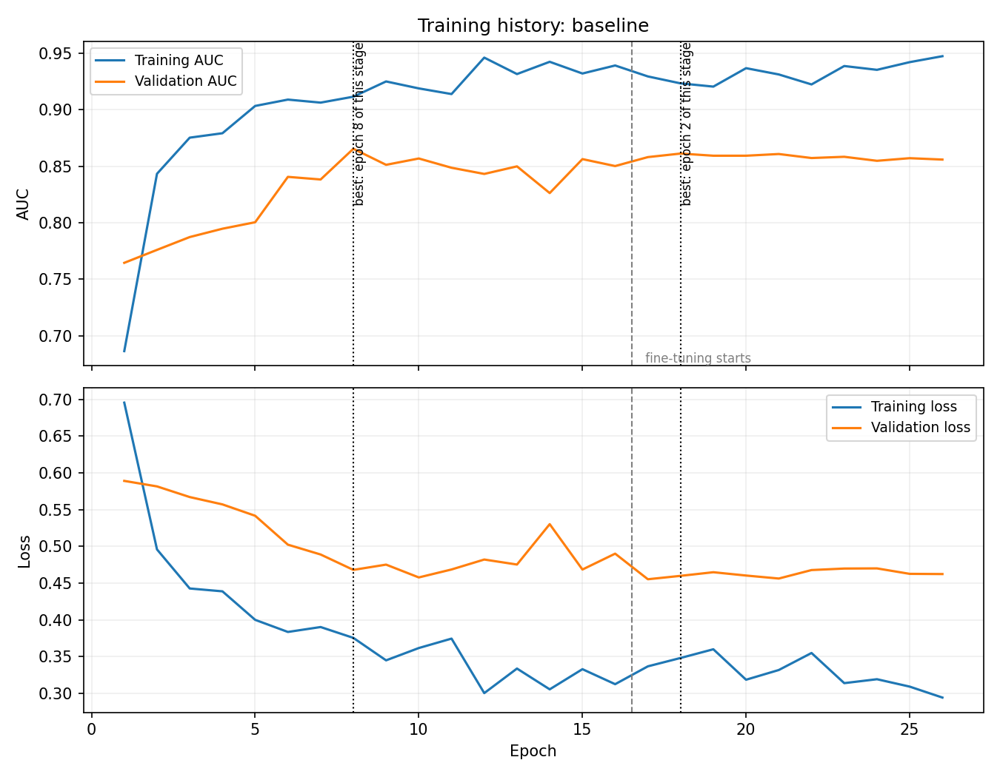

# Model report: baseline

Produced by `ml/scripts/plot_training.py`. Regenerate rather than edit.

## Epochs

| Stage | Epoch limit | Epochs run | Best epoch | Validation AUC |
|---|---|---|---|---|
| Stage 1: classification head | 30 | 16 | 8 (epoch 8 overall) | 0.8654 |
| Stage 2: fine-tuning | 15 | 10 | 2 (epoch 18 overall) | 0.8612 |

**26 epochs were run in total.** The limits are upper bounds, not targets:
early stopping ends a stage once validation AUC has not improved for eight epochs,
and the weights kept are those of the best epoch rather than the last one. Epochs
after the best one are the model improving on the training images while getting
worse on unseen ones, so they are discarded.

## Overfitting or underfitting

At the best epoch of the stage that was kept (stage 2: fine-tuning):

| | Training | Validation | Gap |
|---|---|---|---|
| AUC | 0.9233 | 0.8612 | +0.0621 |
| Accuracy | 0.8515 | 0.7603 | +0.0912 |
| Loss | 0.3482 | 0.4599 | -0.1117 |

**Verdict: mild overfitting**, with an AUC gap of 0.062.

The model scores higher on images it has seen than on images it has not, which is
overfitting by definition. It is not underfitting: underfitting would mean weak
scores on both, whereas training AUC shows the model learned the data well.

The cause is the size of the training set. 559 images is small for a convolutional
network, which is why transfer learning was used rather than training from scratch,
and why augmentation and early stopping are applied.

## Does it generalise

| Validation AUC | Test AUC | Difference |
|---|---|---|
| 0.8930 | 0.8905 | 0.0025 |

Two separate sets of unseen images agree closely. There are two ways to overfit:
fitting the training images too closely, which the gap above shows, and fitting
the validation set through repeated tuning, which would make the final figure
meaningless. This agreement shows the second did not happen.

## Test results

| Metric | Value | 95% confidence interval |
|---|---|---|
| Accuracy | 0.7250 | [0.650, 0.800] |
| Precision | 0.6512 | [0.552, 0.750] |
| Recall | 0.9492 | [0.887, 1.000] |
| Specificity | 0.5082 | [0.382, 0.641] |
| F1 | 0.7724 | [0.694, 0.842] |
| Auc | 0.8905 | [0.825, 0.944] |

56 of 59 TB cases detected; 30 of 61 healthy patients flagged in error.

## Figure

